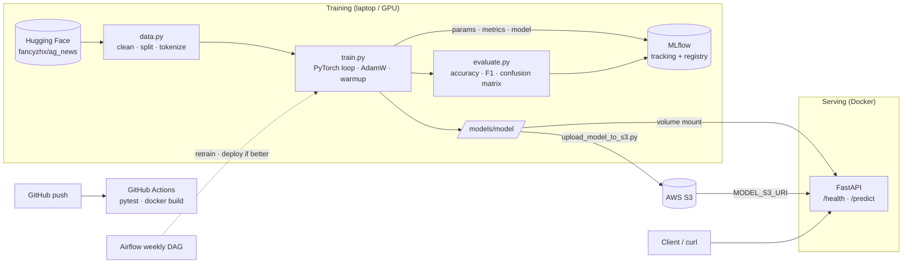
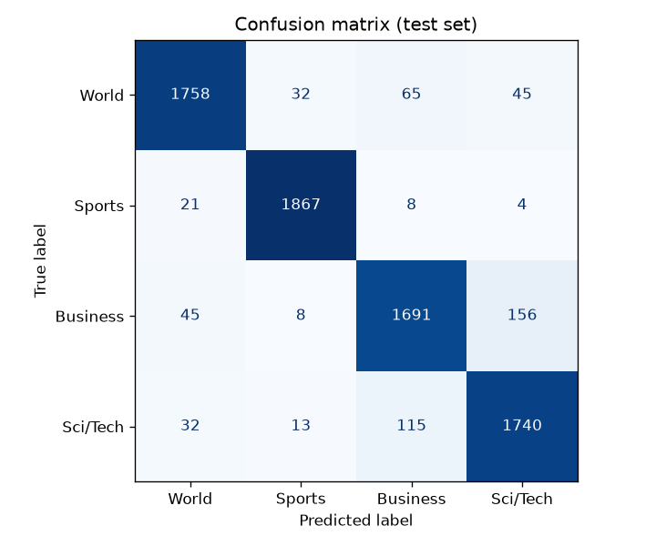

# 📰 news-classifier

End-to-end ML/MLOps project: a fine-tuned **DistilBERT** Transformer classifies news headlines
into **World, Sports, Business, Sci/Tech**. It's served as a **FastAPI** REST API in **Docker**,
with experiment tracking in **MLflow**, tests with **pytest**, CI in **GitHub Actions**, a
deployment guide for **AWS (S3 + EC2)** and a weekly retraining pipeline as an **Airflow** DAG.

```bash
curl -X POST http://localhost:8000/predict -H "Content-Type: application/json" \
     -d '{"text": "Oil prices surge as OPEC cuts production"}'
# {"label":"Business","confidence":0.9941}
```

## Architecture



## Results

All numbers are from real runs on an RTX 4060 Laptop GPU (seed 42). The test set is the
untouched AG News test split.

| Run | Train samples | Epochs | max_len | LR | Val acc | **Test acc** | **Test macro-F1** | Train time |
|---|---|---|---|---|---|---|---|---|
| `fast-lr5e-05` | 2,000 | 1 | 64 | 5e-5 | 0.9040 | 0.8840 | 0.8837 | ~1 min* |
| `fast-lr2e-05` | 2,000 | 1 | 64 | 2e-5 | 0.8820 | 0.8840 | 0.8833 | ~1 min* |
| **`full-lr5e-05`** (served) | 20,000 | 2 | 128 | 5e-5 | 0.9260 | **0.9284** | **0.9284** | ~5 min |

\*FAST test set = 1,000 samples; FULL test set = all 7,600 samples. *Times are on a GPU, CPU is much slower.*

Per class (FULL model, test set):

| Class | Precision | Recall | F1 |
|---|---|---|---|
| World | 0.9472 | 0.9253 | 0.9361 |
| Sports | 0.9724 | 0.9826 | 0.9775 |
| Business | 0.8999 | 0.8900 | 0.8949 |
| Sci/Tech | 0.8946 | 0.9158 | 0.9051 |



**Takeaways:** Sports is easiest (very distinctive vocabulary). Most errors are
**Business ↔ Sci/Tech** (156 + 115 test articles), since news about tech companies is often
both. With 1 short epoch, LR 5e-5 learns faster than 2e-5 (higher val accuracy, lower val loss).
10× more data plus longer inputs bring +4.4 accuracy points.

## Project structure

```
src/config.py        all hyperparameters + presets (fast / full)
src/data.py          load AG News, clean, train/val/test split, tokenize, DataLoaders
src/train.py         manual PyTorch training loop, MLflow logging, model registry
src/evaluate.py      metrics, classification report, confusion matrix
src/predict.py       NewsClassifier.predict(text) -> label + confidence
api/main.py          FastAPI app (/health, /predict), model from local dir or S3
tests/               pytest (fake model -> runs in CI without the real model)
airflow/dags/        weekly retrain DAG (load -> train -> evaluate -> deploy_if_better)
deploy/              S3 upload script + AWS EC2 step-by-step guide
docs/EXPLAINED.md    every concept explained in plain language + interview prep
```

## How to run

### 1. Local setup
```bash
python -m venv .venv            # Python 3.11
.venv\Scripts\activate          # Windows  (Linux/macOS: source .venv/bin/activate)

# GPU (NVIDIA):  pip install torch --index-url https://download.pytorch.org/whl/cu128
# CPU only:      pip install torch --index-url https://download.pytorch.org/whl/cpu
pip install -r requirements.txt
```

### 2. Train and evaluate
```bash
python -m src.train --preset fast --lr 5e-5      # CPU-friendly (2k samples, 1 epoch, len 64)
python -m src.train --preset fast --lr 2e-5      # second experiment for comparison
python -m src.train --preset full --register     # GPU: 20k samples, 2 epochs, len 128

python -m src.train --preset full --skip-if-exists   # model exists -> only evaluate
python -m src.predict "Apple unveils new iPhone"     # quick prediction
```
Flags: `--train-size`, `--epochs`, `--max-len`, `--batch-size`, `--lr`, `--run-name`, `--output-dir`.
Device (cuda / mps / cpu) is detected automatically.

### 3. MLflow UI
```bash
mlflow ui --backend-store-uri sqlite:///mlflow.db --port 5000   # -> http://localhost:5000
```

### 4. API locally
```bash
uvicorn api.main:app --port 8000        # -> http://localhost:8000/docs
pytest -v                               # 13 tests
```

### 5. Docker
```bash
docker build -t news-classifier .
docker run -p 8000:8000 -v ./models:/app/models:ro news-classifier
docker compose up --build              # API on :8000 + MLflow UI on :5000
```

### 6. AWS
See [deploy/AWS_DEPLOY.md](deploy/AWS_DEPLOY.md): S3 bucket → upload model → EC2 with an IAM role → `docker run -e MODEL_S3_URI=...` → curl → **stop the instance**.

## Tech stack
Python 3.11 · PyTorch · Hugging Face transformers & datasets · scikit-learn · pandas · MLflow ·
FastAPI · uvicorn · Docker / docker compose · pytest · GitHub Actions · boto3 / AWS S3 + EC2 · Apache Airflow
